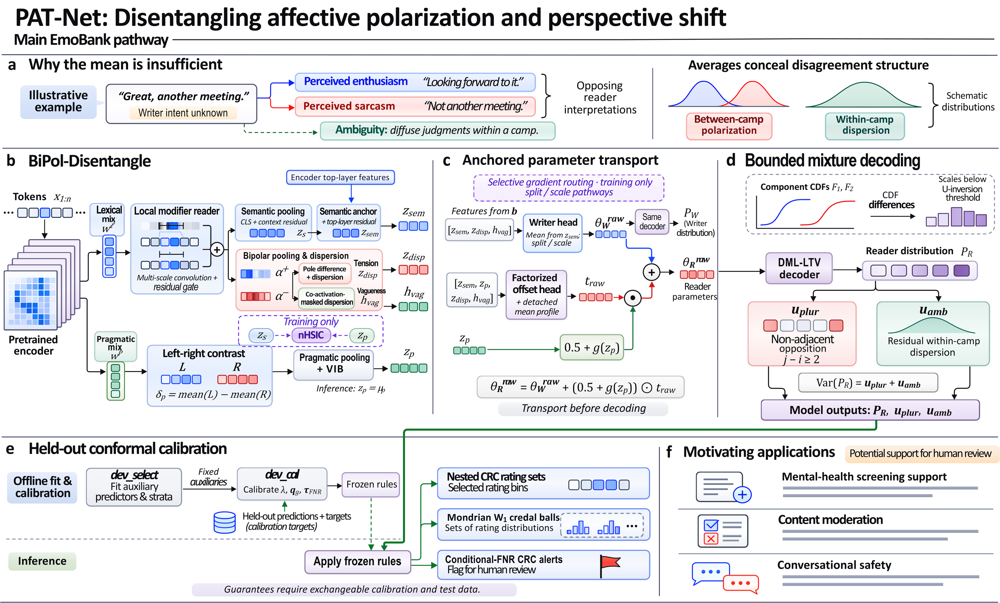

# PAT-Net: Perspective-Aware Affect Distribution Transport & Non-Circular Uncertainty Disentanglement

[](LICENSE)
[](pyproject.toml)
[](requirements.txt)

Official implementation and reproduction suite for:

> **Disentangling affective polarization and perspective shift via identifiable mixture transport and conformal risk control**

`PAT-Net` (`BiPol-Disentangle` + Ordered Discretized Logistic Mixture + Causal Perspective Transport) models disaggregated human affective distributions across **Writer (Producer)** and **Reader (Perceiver)** perspectives, disentangles **Linguistic Ambiguity / Within-Mode Spread** ($U_{\text{amb}}$) from **Pluralistic Polarization / Between-Mode Conflict** ($U_{\text{plur}}$) in a single deterministic forward pass, and calibrates downstream **Mondrian Conformal Credal Sets** and **Conformal Risk Control (CRC)** alerts.

<p align="center">
  
</p>
<p align="center">
  <sub><strong>Architecture Overview (Fig. 1):</strong> PAT-Net decouples lexical semantics, antisymmetric bipolar tension, and pragmatic framing via <code>BiPol-Disentangle</code>, transports anchored Writer parameters toward Reader or demographic targets before scale-bounded <code>DML-LTV</code> mixture decoding, and applies split Conformal Risk Control. Across EmoBank 5-fold CV (verified on RTX 4090), PAT-Net (<code>M4_disentangle</code>) achieves the lowest 1D Wasserstein-1 error across both Reader (<code>0.26121</code>) and Writer (<code>0.23377</code>) perspectives on RoBERTa-base (and <code>0.25866 / 0.23254</code> on DeBERTa-v3-base), overtaking Scalar MSE in Pearson <em>r</em> on DeBERTa-v3 (<code>0.55564 &gt; 0.55184</code>) with a <code>4.77x–6.52x</code> single-pass speedup over 10-pass MC-Dropout.</sub>
</p>

---

## Core Contributions & Architecture

1. **Disentangled Dual-Branch Representation (`src/feature_reader.py`)**: Multi-layer convolutional pooling and anti-cancellation bipolar feature extraction separate shared affective semantics ($z_s$), pragmatic perspective-shift representation ($z_p$), dispersion cues ($z_{\text{disp}}$), and vagueness cues ($h_{\text{vag}}$) regularized by normalized RBF HSIC (`compute_nhsic`).
2. **2-Component Discretized Logistic Mixture (DML) Head (`src/models.py`, `src/losses.py`)**: Predicts calibrated probability mass over discrete ordinal scales (`{1..5}` for EmoBank VAD, `{0..3}` for BRIGHTER) and Beta-Binomial mixtures (`src/epic_exp.py` for EPIC irony proportions), enabling exact differentiable 1D Wasserstein-1 ($W_1$) and CDF transport supervision.
3. **Closed-Form Non-Circular Uncertainty Decomposition (`src/losses.py`)**: Separates within-mode scale spread ($U_{\text{amb}}$) from between-mode bimodal separation ($U_{\text{plur}}$) without relying on multiple stochastic passes or circular variance aliasing.
4. **Causal Perspective Residual Transport ($\mathcal{T}_{W \to R}$)**: Anchors Writer parameters on $(z_s, z_{\text{disp}}, h_{\text{vag}})$ and predicts sparse gated shifts ($\Delta\mu, \Delta\log s, \Delta\alpha$) toward Reader distributions conditioned on pragmatic cues $z_p$, improving both perspective-shift prediction and out-of-genre Leave-One-Genre-Out (LOGO) transfer.
5. **Conformal Credal Sets & Risk Control (`src/conformal_sets.py`)**: Provides distribution-free `90%` finite-sample human coverage sets and FNR-controlled polarization/extremity alerting.

---

## Verified Benchmark Results (Summary from `assets/results/all_gates_report.json`)

| Evaluation Gate / Benchmark | Key Comparisons | Verified Headline Outcome |
| :--- | :--- | :--- |
| **Gate 1 — EmoBank 5-Fold OOF (`roberta-base`, 16 models)** | `patnet_M4` vs. `patnet_unimodal`, `dc_ldl`, `scalar_mse`, etc. | Reader $W_1 = \mathbf{0.26121}$ (best baseline `0.26406`); Pearson $r = 0.54943$ vs. `scalar_mse` `0.55274` (`-0.00331`); Conformal V/A/D coverage `0.89660 / 0.89968 / 0.89950` vs. `scalar_mse` `0.73642 / 0.72318 / 0.77620` |
| **Gate 2 — Non-Circular Disentanglement & Ablation Ladder (`M0`–`M5`)** | Hard polarized shapes (`uplur` vs. `uamb` & `ER@0.8`) | `hard_shape_uplur_auroc = 0.62170 > uamb = 0.61402`; `hard_shape_er08 = 0.61916` beats all single-pass baselines (`dc_ldl = 0.61571`) and MC-T10 epistemic (`0.58581`); `M4` leads all 4 criteria over `M0..M5`; Fold-0 $E=5$ ensemble reaches $W_1 = \mathbf{0.25674}$, $r = \mathbf{0.58310}$ |
| **Gate 3 — Perspective Transport & 7-Genre LOGO** | `patnet` vs. `patnet_no_transport` & `dc_ldl` | 5-fold shift MAE `0.26065 < 0.26457` (`p_holm = 0.0`, 136-cluster bootstrap); asymmetric offense AUROC `0.67112 > 0.64312`; **7/7 genre wins** on LOGO shift MAE (`0.26085 < 0.26694`) |
| **DeBERTa-v3-base 5-Fold & RTX 4090 Efficiency** | `patnet_M4` (`186.897M` total, `26.28 ms` p50, `1129.2 QPS`) | Best $W_1 = \mathbf{0.25866}$ and Reader Pearson $r = \mathbf{0.55564}$ (exceeding `scalar_mse` `0.55184`), CRC polarization FNR `0.07686` (`no_transport = 0.10944`) |
| **Gate 4 — Cross-Dataset (`EPIC` 5-fold + `BRIGHTER` 35 runs)** | `EPIC` (`roberta` + `deberta`) & `BRIGHTER` (`chn/eng/deu/esp`) | `EPIC` shift MAE `0.27814 < 0.29305` (`p = 0.0`), `uplur = 0.6905 > uamb = 0.62364`; `BRIGHTER` restores probability calibration (`deu` ECE `0.03088` vs. `scalar_mse` `0.20283`; `esp` ECE `0.08811`, Pearson `0.66364` vs. `scalar_mse` `0.51622` / `0.26220`) |

---

## Repository Structure

```text
pat-net-release/
├── .github/workflows/ci.yml       # Automated syntax, split isolation, math, and synthetic CI
├── assets/                        # Overview diagram & quantitative paper figures (Fig. 1 – Fig. 7)
│   ├── fig1_framework.png
│   ├── fig2_empirical_phenomena_and_audit.png
│   ├── fig3_emobank_pareto_and_efficiency.png
│   ├── fig4_disentanglement_and_ablation.png
│   ├── fig5_perspective_transport_and_logo.png
│   ├── fig6_cross_dataset_epic_brighter.png
│   ├── fig7_bootstrap_forest_and_conformal.png
│   └── results/                   # Curated gate, audit, and hardware benchmark JSONs
├── configs/
│   └── default.yaml               # Portable training & hyperparameter configuration
├── data/
│   ├── README.md                  # Benchmark provenance, schemas, and rebuild guide
│   ├── raw/.gitkeep               # Destination for raw corpora via scripts/download_data.py
│   └── processed/                 # Leakage-checked Parquet & NPZ benchmark datasets
├── src/
│   ├── feature_reader.py          # BiPol-Disentangle multi-scale reader & nHSIC orthogonality
│   ├── models.py                  # DualPerspectiveAffectModel & matched baselines
│   ├── losses.py                  # 2-component DML, exact 1D W1, shift CDF, parsimony losses
│   ├── datasets.py                # Document-disjoint EmoBank 4-way & LOGO split builders
│   ├── metrics.py                 # Distributional, Esteban-Ray, bootstrap & Holm-Bonferroni tests
│   ├── conformal_sets.py          # Mondrian credal sets & split Conformal Risk Control (CRC)
│   ├── train_emobank.py           # Unified EmoBank training & conformal evaluation entrypoint
│   ├── epic_exp.py                # EPIC perspectivist irony Beta-Binomial transport pipeline
│   ├── brighter_exp.py            # BRIGHTER cross-lingual ordinal intensity pipeline
│   ├── goemotions_exp.py          # GoEmotions Raw rank-2 APM-Net ambiguity vs. pluralism pipeline
│   ├── classical_baselines.py     # C1_SparseRidge & C2_HybridGBDT with OOF token-logit stacking
│   ├── struct_features.py         # Zero-external-lexicon EN+ZH structural & pragmatic surface cues
│   └── paths.py                   # Portable workspace & backbone resolver
├── scripts/
│   ├── verify_reproduction.py     # Offline integrity, split leakage, hygiene & gate verification
│   ├── test_core.py               # Mathematical bounds, gradients, polarization & CRC unit tests
│   ├── test_pipelines_synthetic.py# End-to-end synthetic forward/backward/AMP smoke suite
│   ├── download_data.py           # Stream downloader for EmoBank, GoEmotions, EPIC, BRIGHTER
│   ├── download_backbone.py       # Pretrained HuggingFace backbone mirror downloader
│   ├── prepare_and_audit_*.py     # Corpus reconstruction & empirical gap auditing scripts
│   ├── run_server_pipeline.py     # Resumable Stage 1 / Stage 2 / Stage 3 experiment runner
│   ├── aggregate_eval_gates.py    # 4-gate statistical & conformal aggregator
│   ├── benchmark_latency_vram.py  # GPU p50/p95/p99 latency, throughput & peak VRAM profiler
│   └── generate_paper_figures.py  # Reproducible 5-figure publication suite generator
├── CONTRIBUTING.md
├── pyproject.toml
├── requirements.txt
└── LICENSE
```

---

## Installation & Quick Verification (Offline)

Python `3.10+` and PyTorch `2.2+` are recommended (full GPU training verified on a single 24 GB NVIDIA RTX 4090).

```bash
python -m venv .venv
# Linux/macOS: source .venv/bin/activate
# Windows PowerShell: .\.venv\Scripts\Activate.ps1
pip install -r requirements.txt
```

Validate syntax, dataset leakage freedom, math bounds, synthetic training steps, and repository hygiene immediately without internet access:

```bash
python -m compileall -q src scripts
python scripts/verify_reproduction.py
python scripts/test_core.py
python scripts/test_pipelines_synthetic.py
```

---

## End-to-End Reproduction

### 1. Download Optional Raw Corpora & Pretrained Backbones
*(Needed for raw audit scripts, multilingual `BRIGHTER`, and offline HF backbones; `data/processed/` already supports immediate offline EmoBank, EPIC, and GoEmotions runs once backbones are cached.)*

```bash
python scripts/download_data.py
python scripts/download_backbone.py --repo roberta-base
python scripts/download_backbone.py --repo microsoft/deberta-v3-base
python scripts/download_backbone.py --repo xlm-roberta-base
```

### 2. Run Full Resumable Benchmark Stages

```bash
# Quick GPU/CPU smoke check
python scripts/run_server_pipeline.py --stage smoke

# Stage 1: EmoBank 5-fold CV (all baselines, PAT-Net M4/M5, MC-Dropout T=10, Fold-0 E=5 ensembles)
python scripts/run_server_pipeline.py --stage stage1

# Stage 2: M0..M3 ablations, DeBERTa-v3 5-fold replication, 7-genre LOGO, & hardware latency/VRAM benchmark
python scripts/run_server_pipeline.py --stage stage2

# Stage 3: EPIC 5-fold irony transport & BRIGHTER (chn, eng, deu, esp) cross-lingual ordinal calibration
python scripts/run_server_pipeline.py --stage stage3

# Aggregate Gates 1-4, regenerate paper figures, and verify reproduction
python scripts/aggregate_eval_gates.py
python scripts/generate_paper_figures.py
python scripts/verify_reproduction.py --with-outputs
```

---

## License

- Source code and configuration files are released under the **MIT License** ([LICENSE](LICENSE)).
- Curated benchmark corpora under `data/` correspond to upstream public datasets (`EmoBank`, `GoEmotions`, `EPIC`, `BRIGHTER`) and remain subject to their original licenses (see [data/README.md](data/README.md)).
